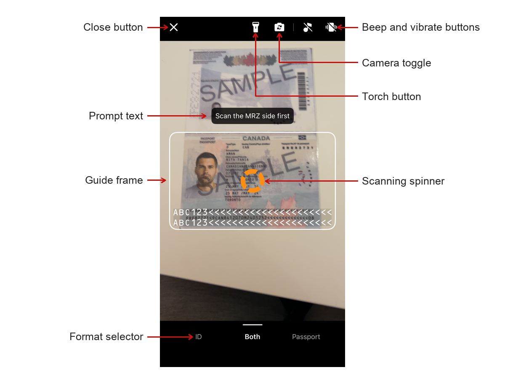

# Customizing the MRZ Scanner

This page shows how to configure the MRZ Scanner through the `MRZScannerConfig` class.

## MRZScannerConfig Overview

[**`MRZScannerConfig`**](../api-reference/mrz-scanner-config.md) carries almost every option the MRZ Scanner exposes. Create one, set the properties you need, and pass it to `MRZScanner.Start(config)`. The scanner reads it when it starts, so a change takes effect on the next scan.

`MRZScannerConfig` contains the following properties:

1. **`License`** - the **only property you must set**; every other property has a working default. If the license is missing, invalid, or expired, the scanner shows an error telling the user to contact the app administrator.
2. **`DocumentType`** (default `EnumDocumentType.All`) - the type of document to recognize: `All`, `Id`, or `Passport`. See [Supported Document Types](../../shared/supported-document-types.md).
3. **`TemplateFile`** (default `null`) - a custom Capture Vision template, as an app asset name, a file path, or a JSON string. Contact the [Dynamsoft Technical Support Team](https://www.dynamsoft.com/contact/) for help with templates.
4. **`IsBeepEnabled`** (default `false`) - plays a beep on a successful scan.
5. **`IsVibrateEnabled`** (default `false`) - vibrates the device on a successful scan.
6. **`IsCloseButtonVisible`** (default `true`) - shows the button that closes the scanner.
7. **`IsTorchButtonVisible`** (default `true`) - shows the flashlight toggle.
8. **`IsCameraToggleButtonVisible`** (default `true`) - shows the front/rear camera toggle.
9. **`IsBeepButtonVisible`** (default `true`) - shows the toggle that turns the beep on or off.
10. **`IsVibrateButtonVisible`** (default `true`) - shows the toggle that turns vibration on or off.
11. **`IsFormatSelectorVisible`** (default `true`) - shows the selector for ID cards, passports, or both.
12. **`IsGuideFrameVisible`** (default `true`) - shows the guide frame. Hiding it also changes what is scanned; see [Hiding the guide frame](#hiding-the-guide-frame).
13. **`ReturnDocumentImage`** (default `true`) - includes the cropped document images in the result.
14. **`ReturnPortraitImage`** (default `true`) - includes the portrait in the result. It also drives two-sided scanning; see [Scanning Two-Sided Documents](index.md#scanning-two-sided-documents).
15. **`ReturnOriginalImage`** (default `false`) - includes the full camera frames in the result.
16. **`IsCameraPermissionPromptEnabled`** (default `true`) - shows the scanner's own prompt when camera access is unavailable; see [Handling Camera Permission](#handling-camera-permission).

The sections below show these properties in use.

## Setting the MRZ Document Type

### Using the API

Restricting the document type improves processing speed and accuracy:

```csharp
var config = new MRZScannerConfig("DLS2eyJvcmdhbml6YXRpb25JRCI6IjIwMDAwMSJ9");
config.DocumentType = EnumDocumentType.Passport;
```

### Using a customized template file

A template is a JSON file of algorithm settings for specialized scenarios. It replaces the built-in templates, so `DocumentType` has no effect, and on iOS the format selector is hidden. [Contact us](https://www.dynamsoft.com/contact/) to get a customized template.

1. Add the template to your project's **Resources/Raw** folder, so it's bundled as a MAUI asset.
2. Pass its file name:

   ```csharp
   var config = new MRZScannerConfig("DLS2eyJvcmdhbml6YXRpb25JRCI6IjIwMDAwMSJ9");
   config.TemplateFile = "CustomizedTemplate.json";
   ```

> [!NOTE]
> `TemplateFile` also accepts a file path on the device, or the template's JSON as a string.

**Related APIs**

- [`DocumentType`](../api-reference/mrz-scanner-config.md#documenttype)
- [`TemplateFile`](../api-reference/mrz-scanner-config.md#templatefile)

## Configure the UI Elements

<div align="center">
    <p></p>
    <p>MRZ Scanner UI</p>
</div>

The MRZ Scanner UI includes the following configurable elements:

- **Close button**: closes the scanner and returns to the previous page.
- **Torch button**: turns the flashlight on or off for low light.
- **Camera toggle button**: switches between the front and rear cameras.
- **Beep button**: turns the success beep on or off.
- **Vibrate button**: turns the success vibration on or off.
- **Prompt text**: guides the user through each step of the scan.
- **Guide frame**: shows where to place the document.
- **Format selector**: chooses ID card, passport, or both.

The scanning spinner isn't configurable; see [The Scanner Screen](index.md#the-scanner-screen) for what it means.

All UI elements are visible by default. Hide the ones you don't need:

```csharp
var config = new MRZScannerConfig("DLS2eyJvcmdhbml6YXRpb25JRCI6IjIwMDAwMSJ9");
config.IsCloseButtonVisible = false;
config.IsTorchButtonVisible = false;
config.IsCameraToggleButtonVisible = false;
config.IsBeepButtonVisible = false;
config.IsVibrateButtonVisible = false;
config.IsFormatSelectorVisible = false;
config.IsGuideFrameVisible = false;
```

### Hiding the guide frame

The guide frame defines the area the scanner reads, so hiding it changes behavior as well as appearance. With `IsGuideFrameVisible = false`:

- **The whole camera preview is scanned**, so a document elsewhere in the shot can be picked up.
- **Each frame costs more to process**, which raises CPU load and battery use.
- **The prompt text is hidden too**, since it's a label on the frame.
- **The spinner and the flip prompt remain**, because the user still needs them.

**Related APIs**

- [`IsCloseButtonVisible`](../api-reference/mrz-scanner-config.md#isclosebuttonvisible)
- [`IsTorchButtonVisible`](../api-reference/mrz-scanner-config.md#istorchbuttonvisible)
- [`IsCameraToggleButtonVisible`](../api-reference/mrz-scanner-config.md#iscameratogglebuttonvisible)
- [`IsBeepButtonVisible`](../api-reference/mrz-scanner-config.md#isbeepbuttonvisible)
- [`IsVibrateButtonVisible`](../api-reference/mrz-scanner-config.md#isvibratebuttonvisible)
- [`IsFormatSelectorVisible`](../api-reference/mrz-scanner-config.md#isformatselectorvisible)
- [`IsGuideFrameVisible`](../api-reference/mrz-scanner-config.md#isguideframevisible)

## Enabling Haptic and Audio Feedback

The scanner can beep or vibrate on a successful scan. Both are off by default:

```csharp
var config = new MRZScannerConfig("DLS2eyJvcmdhbml6YXRpb25JRCI6IjIwMDAwMSJ9");
config.IsBeepEnabled = true;     // beep on a successful scan
config.IsVibrateEnabled = true;  // vibrate on a successful scan
```

> [!NOTE]
> These set the starting behavior; users can still change it with the beep and vibrate buttons unless you hide them. On iOS the beep is a system sound, so the ringer's silent mode mutes it.

**Related APIs**

- [`IsBeepEnabled`](../api-reference/mrz-scanner-config.md#isbeepenabled)
- [`IsVibrateEnabled`](../api-reference/mrz-scanner-config.md#isvibrateenabled)
- [`IsBeepButtonVisible`](../api-reference/mrz-scanner-config.md#isbeepbuttonvisible)
- [`IsVibrateButtonVisible`](../api-reference/mrz-scanner-config.md#isvibratebuttonvisible)

## Configure Scan Result Images

By default the result includes the cropped document images and the portrait. Turn off what you don't need to save memory and processing:

```csharp
var config = new MRZScannerConfig("DLS2eyJvcmdhbml6YXRpb25JRCI6IjIwMDAwMSJ9");
config.ReturnDocumentImage = true;   // cropped document images (default: true)
config.ReturnPortraitImage = true;   // portrait image (default: true)
config.ReturnOriginalImage = false;  // full camera frames (default: false)
```

Read the images from the `MRZScanResult` with `GetDocumentImage(EnumDocumentSide)`, `GetOriginalImage(EnumDocumentSide)`, and `GetPortraitImage()`. See [Results and Image Lifetime](index.md#results-and-image-lifetime) for converting them to a MAUI `ImageSource`.

**Related APIs**

- [`ReturnDocumentImage`](../api-reference/mrz-scanner-config.md#returndocumentimage)
- [`ReturnPortraitImage`](../api-reference/mrz-scanner-config.md#returnportraitimage)
- [`ReturnOriginalImage`](../api-reference/mrz-scanner-config.md#returnoriginalimage)
- [`GetDocumentImage`](../api-reference/mrz-scan-result.md#getdocumentimage)
- [`GetOriginalImage`](../api-reference/mrz-scan-result.md#getoriginalimage)
- [`GetPortraitImage`](../api-reference/mrz-scan-result.md#getportraitimage)

## Handling Camera Permission

The scanner manages the camera permission for you and never opens the camera without access. On iOS, the only setup is the [camera usage description](index.md#step-3-declare-the-camera-usage-description).

If access is unavailable, the scanner explains the situation and offers what can resolve it:

| State | Scanner's prompt |
| ----- | ---------------- |
| The user denied camera access | iOS: **Open Settings**. Android: **Allow camera access** while it can still be requested, otherwise **Open Settings** |
| Device policy restricts the camera | An explanation only; the user can't change it |

If the scan ends without access, the outcome is reported as `EnumResultStatus.Exception` with an `ErrorCode` of `CameraPermissionDenied` (1001) or `CameraPermissionRestricted` (1002). On Android, the scan continues if the user grants access from the prompt, and only **Cancel** reports the denial.

> [!IMPORTANT]
> On iOS, the system asks for camera access only **once per install**, and changing the permission in Settings **terminates the app**. A page that shows a denial should keep its own route into Settings. The [ScanMRZ Demo App](../samples/scanmrz-walkthrough.md#recovering-from-a-permission-denial) shows this.

### Presenting your own permission UI

To replace the scanner's prompt with your own, turn it off and read the error code:

```csharp
var config = new MRZScannerConfig("DLS2eyJvcmdhbml6YXRpb25JRCI6IjIwMDAwMSJ9");
config.IsCameraPermissionPromptEnabled = false;

var result = await MRZScanner.Start(config);
if (result.ErrorCode == (int)EnumErrorCode.CameraPermissionDenied)
{
    // Explain, and offer a button that calls AppInfo.ShowSettingsUI().
}
else if (result.ErrorCode == (int)EnumErrorCode.CameraPermissionRestricted)
{
    // Explain that the camera is restricted; Settings can't change it.
}
```

The denial is still reported, and the camera still never starts without access.

**Related APIs**

- [`IsCameraPermissionPromptEnabled`](../api-reference/mrz-scanner-config.md#iscamerapermissionpromptenabled)
- [`EnumErrorCode`](../api-reference/error-code.md)
- [`ErrorCode`](../api-reference/mrz-scan-result.md#errorcode)

## Further Customization

If you have other customization requirements for the `MRZScanner` component, contact the [Dynamsoft Support Team](https://www.dynamsoft.com/contact/).
