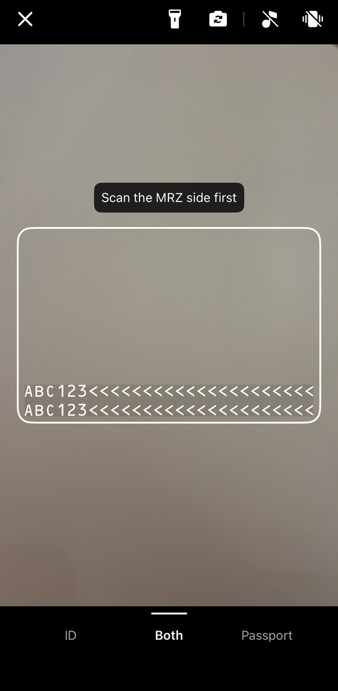
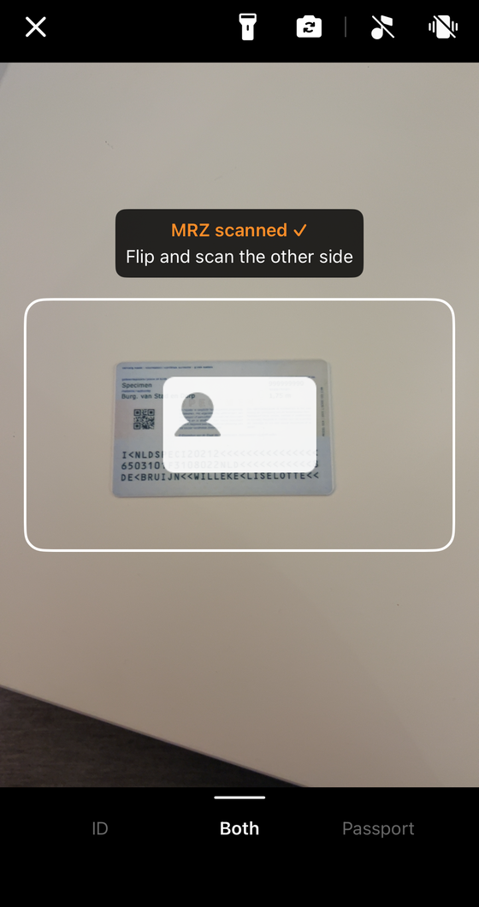

# MRZ Scanner User Guide (MAUI Edition)

The Dynamsoft MRZ Scanner (MAUI Edition) provides a ready-to-use scanning component for Android and iOS apps. This guide builds an MRZ scanning app from scratch using `MRZScanner`, whose `Start` method opens the built-in camera UI and returns the result.

> [!TIP]
> The app built here is **ScanMRZBasic**, available on [GitHub](https://github.com/Dynamsoft/mrz-scanner-mobile-maui/tree/main/ScanMRZBasic). For a fuller app with a dedicated result page, document images, and camera-permission recovery, see the [ScanMRZ Demo App](../samples/scanmrz-walkthrough.md).

> [!IMPORTANT]
> Upgrading an existing integration rather than starting fresh? See the [Upgrade Guide](upgrade.md) first.

## Supported Document Types

The SDK supports three ICAO Machine Readable Travel Document (MRTD) formats: **TD1** (ID cards, 3-line MRZ), **TD2** (ID cards, 2-line MRZ), and **TD3** (passports, 2-line MRZ). For a visual reference of each format, see [Supported Document Types](../../shared/supported-document-types.md).

> [!NOTE]
> To request support for other MRTD types, contact the [Dynamsoft Support Team](https://www.dynamsoft.com/contact/).

## System Requirements

- .NET: **.NET 10** SDK or later with the `maui` workload, and **.NET MAUI 10.0.20** or later.
- Android: **Android 5.0** (API Level 21) or higher; ABIs **armeabi-v7a**, **arm64-v8a**, **x86** and **x86_64**; JDK **17** or later.
- iOS: **iOS 16** or higher, as required by the Core ML models the scanner ships; **arm64**; a Mac with the Xcode version your .NET iOS workload requires.
- Development Environment: **Visual Studio Code** with the **C# Dev Kit** and **.NET MAUI** extensions, or **Visual Studio 2026** on Windows (iOS builds need a paired Mac).
- Hardware: **a physical device**. Simulators and most emulators don't expose a camera, so the scanner can't run on them.

> [!NOTE]
> Each .NET for iOS release names the Xcode it requires in its [release notes](https://github.com/dotnet/macios/releases){:target="_blank"}. Apple's [Xcode system requirements](https://developer.apple.com/support/xcode/){:target="_blank"} list the macOS each Xcode needs.

## Licensing

A valid license key is required to use the SDK. If you are just getting started, request a free 30-day trial license below:



> [!NOTE]
>
> - The license string above grants a time-limited free trial which requires a network connection.
> - You can request a 30-day trial license via the [Request a Trial License](https://www.dynamsoft.com/customer/license/trialLicense?product=mrz&utm_source=guide&package=maui){:target="_blank"} link.
> - For production license setup, see the [License Activation](license-activation.md) guide.

## Add the SDK

1. Add the [`Dynamsoft.MRZScannerBundle.Maui`](https://www.nuget.org/packages/Dynamsoft.MRZScannerBundle.Maui){:target="_blank"} package from the project folder:

   ```bash
   dotnet add package Dynamsoft.MRZScannerBundle.Maui --version 3.6.2000
   ```

   This adds the following line to your `.csproj`, and brings in the Android and iOS bindings and the Capture Vision packages they depend on:

   ```xml
   <PackageReference Include="Dynamsoft.MRZScannerBundle.Maui" Version="3.6.2000" />
   ```

2. The package supports **Android and iOS** only. The MAUI project template also targets Mac Catalyst and Windows, so keep just these two in your `.csproj`:

   ```xml
   <TargetFrameworks>net10.0-android;net10.0-ios</TargetFrameworks>
   ```

3. Raise the iOS minimum to **16.0**. The MAUI template sets 15.0, and the build doesn't warn about the difference:

   ```xml
   <SupportedOSPlatformVersion Condition="$([MSBuild]::GetTargetPlatformIdentifier('$(TargetFramework)')) == 'ios'">16.0</SupportedOSPlatformVersion>
   ```

## Building the MRZ Scanner Application

The following steps build **ScanMRZBasic**, the smallest app that scans an MRZ and shows the parsed result. You can download the finished project from [GitHub](https://github.com/Dynamsoft/mrz-scanner-mobile-maui/tree/main/ScanMRZBasic).

The whole app is one page: a button opens the scanner, and the result shows above it. For a fuller app with a dedicated result page, document images, per-field validation explanations, and camera-permission recovery, see the [ScanMRZ Demo App](../samples/scanmrz-walkthrough.md).

Before you start, have these ready:

- **A license key**. A trial key is embedded in the code below. See [Licensing](#licensing) to request your own.
- **A physical Android or iOS device**. For iOS, also an Apple ID signed in to Xcode; Step 6 covers signing.
- **A document to scan**: any passport or ID card with a TD1, TD2, or TD3 machine-readable zone.

### Step 1: Create a New Project

Create a **.NET MAUI App** named *ScanMRZBasic* on **.NET 10**:

- **Visual Studio Code**: run **.NET: New Project...** from the Command Palette and choose **.NET MAUI App**.
- **Visual Studio 2026**: select **Create a new project**, then **.NET MAUI App**.
- **Command line**: `dotnet new maui -n ScanMRZBasic`

> [!NOTE]
> Apps built with Xcode 27 must adopt the iOS UIScene lifecycle, or iOS terminates them at launch. Projects created from the current MAUI template already include it (`Platforms/iOS/SceneDelegate.cs`).

### Step 2: Add the SDK

Follow the steps in the [Add the SDK](#add-the-sdk) section above: add the package, keep the Android and iOS targets, and raise the iOS minimum to 16.0.

### Step 3: Declare the Camera Usage Description

iOS requires every app that opens the camera to say why. Add `NSCameraUsageDescription` to **Platforms/iOS/Info.plist**:

```xml
<key>NSCameraUsageDescription</key>
<string>Open Camera to Scan MRZ.</string>
```

> [!IMPORTANT]
> Without this key the app **crashes** the moment the scanner opens the camera. The string is what iOS shows in its permission alert.

Android needs no setup: the SDK adds the `CAMERA` permission to your app's manifest, and the template already declares the `INTERNET` permission the license needs.

### Step 4: Build the Page

Open **MainPage.xaml** and replace its contents. The page has a scrolling result label and a **Scan an MRZ** button pinned to the bottom.

```xml
<?xml version="1.0" encoding="utf-8" ?>
<ContentPage xmlns="http://schemas.microsoft.com/dotnet/2021/maui"
             xmlns:x="http://schemas.microsoft.com/winfx/2009/xaml"
             x:Class="ScanMRZBasic.MainPage">

    <Grid RowDefinitions="*,Auto" Padding="16" RowSpacing="16">
        <ScrollView>
            <Label x:Name="ResultLabel" />
        </ScrollView>
        <Button Grid.Row="1" Text="Scan an MRZ" Clicked="OnScanMRZ" />
    </Grid>

</ContentPage>
```

The project won't compile yet: Step 5 replaces the template's code-behind with the `OnScanMRZ` handler.

### Step 5: Launch the Scanner and Show the Result

Open **MainPage.xaml.cs** and replace its contents. This is the whole application: it supplies the license, starts the scanner, and handles all three result statuses.

For optional settings like document type filtering, UI visibility, and image capture, see the [Customize MRZ Scanner](customize-mrz-scanner.md) guide.

```csharp
using Dynamsoft.CodeParser.Maui;
using Dynamsoft.MRZScannerBundle.Maui;

namespace ScanMRZBasic;

public partial class MainPage : ContentPage
{
    // Android can rebuild this page while the scanner is open, so the text outlives it.
    private static string _resultText = "";

    public MainPage()
    {
        InitializeComponent();
    }

    protected override void OnAppearing()
    {
        base.OnAppearing();
        ResultLabel.Text = _resultText;
    }

    private async void OnScanMRZ(object? sender, EventArgs e)
    {
        // A trial license, so it needs a network connection. Request your own at
        // https://www.dynamsoft.com/customer/license/trialLicense/?product=mrz&utm_source=guide&package=maui
        var result = await MRZScanner.Start(new MRZScannerConfig("DLS2eyJvcmdhbml6YXRpb25JRCI6IjIwMDAwMSJ9"));

        _resultText = result.ResultStatus switch
        {
            EnumResultStatus.Finished when result.Data is { } data => Describe(data),
            EnumResultStatus.Canceled => "Scan canceled",
            EnumResultStatus.Exception => result.ErrorString ?? "",
            _ => ""
        };
        ResultLabel.Text = _resultText;
    }

    private static string Describe(MRZData data)
    {
        // The fields the scanner checks against the MRZ check digits.
        string[] validatedFields = ["firstName", "lastName", "sex", "issuingState", "nationality", "dateOfBirth",
            "dateOfExpire", "documentNumber", "mrzText", "optionalData1", "optionalData2", "personalNumber"];
        var invalidFields = validatedFields.Where(f => data.GetFieldValidationStatus(f) == EnumValidationStatus.VS_FAILED);

        return $"""
            Name: {data.FirstName} {data.LastName}
            Document Number: {data.DocumentNumber}
            Nationality: {data.Nationality}
            Date of Birth: {data.DateOfBirth}
            Date of Expiry: {data.DateOfExpire}
            Document Type: {data.DocumentType}
            Invalid Fields: [{string.Join(", ", invalidFields)}]
            MRZ Text:
            {data.MrzText}
            """;
    }
}
```

You don't need any camera-permission code. The scanner never opens the camera without access; when access is unavailable it offers **Open Settings**, then returns `Exception` with a readable `ErrorString`.

> [!NOTE]
> To present your own permission UI instead, set `IsCameraPermissionPromptEnabled = false`. See [Handling Camera Permission](customize-mrz-scanner.md#handling-camera-permission).

**Key APIs in use**

- **[`MRZScannerConfig`](../api-reference/mrz-scanner-config.md)**: carries your license and any optional settings.
- **[`MRZScanner.Start`](../api-reference/mrz-scanner.md#start)**: opens the scanner full screen and completes with the result when it closes.
- **[`ResultStatus`](../api-reference/mrz-scan-result.md#resultstatus)**: `Finished`, `Canceled`, or `Exception`. Cancellation and failure come back through the result rather than as exceptions, so handle all three.
- **[`ErrorString`](../api-reference/mrz-scan-result.md#errorstring)**: a readable message for `Exception`. [`ErrorCode`](../api-reference/mrz-scan-result.md#errorcode) gives the code behind it.
- **[`Data`](../api-reference/mrz-scan-result.md#data)**: the parsed [`MRZData`](../api-reference/mrz-data.md). It's `null` for the other statuses.
- **`_resultText`**: a static field, because Android can rebuild the page while the scanner is open. See [Results and Image Lifetime](#results-and-image-lifetime).

**Reading a field's validation status**

Most MRZ fields are protected by a check digit. [`GetFieldValidationStatus`](../api-reference/mrz-data.md#getfieldvalidationstatus) reports whether the value read from the document matched it, using the camelCase field names of the native libraries. `Describe` lists every field that returns `VS_FAILED`, meaning the document may be misread, invalid, or altered. The value is still returned, so you can accept it, re-scan, or ask for a correction.

`EnumValidationStatus` lives in the `Dynamsoft.CodeParser.Maui` namespace, which is why the page needs `using Dynamsoft.CodeParser.Maui;`.

> [!TIP]
> The [ScanMRZ Demo App](../samples/scanmrz-walkthrough.md) shows a richer treatment of the same API: failed fields are marked on the result page, and tapping one explains what a failed check digit means.

### Step 6: Run the Project

1. **Configure iOS signing.** Sign in to your Apple Developer account in Xcode under **Settings > Accounts**. You need a development certificate and a provisioning profile for the app's bundle identifier; the simplest way is to let Xcode create them by building an Xcode project with the same bundle identifier and **Automatically manage signing** turned on.
2. **Connect your device.** For Android, enable USB debugging. For iOS, unlock the device and trust the computer.
3. **Run the app.**
   - **Visual Studio Code**: pick the device with **.NET MAUI: Select Startup Device** in the Command Palette, then start debugging. If the folder holds more than one app, choose it first with **.NET MAUI: Select Startup Project**.
   - **Visual Studio 2026**: select the device in the toolbar, then start debugging. For iOS, pair with a Mac first under **Tools > iOS > Pair to Mac**.
   - **Command line**: for Android, run `dotnet build -t:Run -f net10.0-android`. For iOS, build first, then run:

     ```bash
     dotnet build -f net10.0-ios -p:RuntimeIdentifier=ios-arm64
     dotnet build -t:Run -f net10.0-ios -p:RuntimeIdentifier=ios-arm64
     ```

     With more than one device connected, add `-p:_DeviceName=<UDID>` to the run command. `xcrun xctrace list devices` shows each device's UDID.

Tap **Scan an MRZ** and point the camera at the machine-readable zone of a passport or ID card. The scanner closes as soon as it has what it needs, and the parsed fields appear on the page.

## Results and Image Lifetime

### How the result arrives

- **`Start` completes once per scan**, with any of the three statuses. Nothing is thrown for a failed scan, so a scan that seems to do nothing is usually an unhandled status.
- **Only one scanner opens at a time.** Calling `Start` again during a scan, for example from a double tap, returns the running scan's task.
- **You can navigate or show an alert as soon as `Start` returns.** On iOS the result arrives while the scanner is still closing.
- **On Android, the page that started the scan can be rebuilt** while the scanner is open, for example under memory pressure. `Start` still completes, but on the old page instance. Keep the result outside the page, such as in a static field, a view model, or a service, and show it when the visible page appears. ScanMRZBasic does this with `_resultText` and `OnAppearing`.

### How long the images stay valid

[`GetDocumentImage`](../api-reference/mrz-scan-result.md#getdocumentimage), [`GetOriginalImage`](../api-reference/mrz-scan-result.md#getoriginalimage) and [`GetPortraitImage`](../api-reference/mrz-scan-result.md#getportraitimage) return `ImageData`, a managed copy of the pixels. It stays valid as long as you hold it, and there's nothing to release.

Call `ToImageSource()` to show an image in a MAUI `Image`. It copies and encodes the image on the calling thread, so convert large images off the UI thread:

```csharp
var source = await Task.Run(() => result.GetPortraitImage()?.ToImageSource());
```

What's worth planning for is **size**: `ImageData` holds uncompressed pixels, and `ReturnOriginalImage` adds a full camera frame per document side. Leave it off unless you need the uncropped frame.

## The Scanner Screen

The scanner supplies its own full-screen UI: a live camera preview with a **guide frame** marking where to place the document, a **toolbar** with the close, torch, camera-toggle, beep, and vibrate buttons, a **format selector** for ID, passport, or both, and a **prompt** that updates as the scan progresses. Each of these can be hidden; see [Configure the UI Elements](customize-mrz-scanner.md#configure-the-ui-elements).

<div align="center">
    <p></p>
    <p>The scanner waiting for a document</p>
</div>

### What the user is told

| Stage | On screen |
| ----- | --------- |
| Waiting for a document | **Scan the MRZ side first** |
| Text lines detected in frame | A spinner at the center of the guide frame |
| MRZ read, nothing further needed | **MRZ scanned ✓** |
| MRZ read, portrait found on the same side | **MRZ scanned ✓ / Portrait scanned ✓** |
| MRZ read, still looking for a portrait | **MRZ scanned ✓ / Finding portrait...** |
| No portrait found after five seconds | **MRZ scanned ✓ / No portrait detected** |
| MRZ read, opposite side needed | **MRZ scanned ✓ / Flip and scan the other side**, with an animated flip prompt |
| Both sides captured | **MRZ scanned ✓ / Both sides scanned ✓** |

The frame border turns green once a scan is complete. The spinner appears only while the scanner can see MRZ-like text, so it's the user's cue to hold the device steady.

## Scanning Two-Sided Documents

On a passport, the MRZ and the portrait share one page. On most TD1 and TD2 ID cards they're on opposite sides, so the scanner asks the user to flip the card. It handles this itself; your code doesn't change.

The scanner always reads the **MRZ side first**, which is why the API names the sides `EnumDocumentSide.MRZ` and `EnumDocumentSide.Opposite`.

### What happens during a scan

1. The user scans the MRZ side, which fills the `MRZ` images.
2. If a portrait is found on that side, the scan ends there and the `Opposite` images stay `null`.
3. Otherwise, for an ID card, the scanner asks the user to flip the document. The other side fills the `Opposite` images, and the portrait is taken from it.

<div align="center">
    <p></p>
    <p>The flip prompt on a two-sided ID card</p>
</div>

> [!NOTE]
> Five seconds after the scanner starts looking for a portrait, a **Continue scanning or tap to finish →** label lets the user finish with what has been captured. The `Opposite` images and the portrait are then `null`, so treat them as optional.

### What you get back

With default settings:

| Document | `GetDocumentImage(MRZ)` | `GetDocumentImage(Opposite)` | `GetPortraitImage()` |
| -------- | ----------------------- | ---------------------------- | -------------------- |
| Passport (TD3) | image | `null` | from the MRZ side |
| ID card (TD1 / TD2) | image | image | from the opposite side |
| Any document, with `ReturnPortraitImage = false` | image | `null` | `null` |

`GetOriginalImage` follows the same pattern once `ReturnOriginalImage` is `true`.

### Turning it off

Two-sided scanning is driven by the portrait. Setting `ReturnPortraitImage` to `false` ends every scan as soon as the MRZ is read:

```csharp
var config = new MRZScannerConfig("YOUR-LICENSE-KEY");
config.ReturnPortraitImage = false;
```

For an example that displays the images from both sides, see the [ScanMRZ Demo App](../samples/scanmrz-walkthrough.md).

## Starting the Scanner from a Modal Page

ScanMRZBasic starts the scanner from its main page and shows the result on that same page, so it never closes one page or opens another. Apps that start the scan from a modal page (opened with `Navigation.PushModalAsync`) usually close the modal afterwards and show the result on a new page. The scanner opens over the modal with no extra code, but wait for the modal to finish closing before navigating: on iOS, a page pushed while the modal is still closing can be removed again, with no error.

Start the scan from the modal page's own button handler:

```csharp
var result = await MRZScanner.Start(config);
await Navigation.PopModalAsync();   // wait for the modal to close
await Shell.Current.Navigation.PushAsync(new ResultPage(result));
```

- `PopModalAsync` completes only when the modal has finished closing, so await it before navigating. Android closes modals almost instantly, but the same order is safe there too.
- Don't use `OnAppearing` or `Navigation.ModalStack.Count` to detect that the modal has closed: both report it closed before the animation ends.
- The reverse applies too: on iOS, `Start` can't open the scanner while a page is still animating, and returns an `Exception` result. Await `PopModalAsync` before starting a scan.
- Alternatively, close the modal first and start the scan from the page underneath.

## Preparing for Release

### Trimming

No trimming or linker configuration is needed. Release builds with the default trimming settings run correctly on both platforms.

### App size

Most of the footprint is the Dynamsoft Capture Vision engine and its models. Measured from a Release build of `ScanMRZBasic`:

| Platform | Component | Size |
| -------- | --------- | ---- |
| Android | SDK native libraries, `arm64-v8a` | ~16 MB |
| Android | SDK native libraries, `x86_64` | ~19 MB |
| iOS | `DynamsoftCaptureVisionBundle.framework` | ~12 MB |
| iOS | `DynamsoftMRZScannerBundle.framework` | ~6.7 MB |

- **Android**: MAUI Release builds include only `arm64-v8a` and `x86_64` by default. To support 32-bit devices, add `android-arm` to `RuntimeIdentifiers`. Publish an Android App Bundle so Google Play delivers only the matching ABI.
- **iOS**: the frameworks' device slices are arm64 only, so there is nothing to filter.

### 16 KB page sizes

All of the SDK's Android native libraries are aligned for 16 KB page sizes. No action is needed.

### Privacy manifests

Both iOS frameworks include an Apple privacy manifest (`PrivacyInfo.xcprivacy`), embedded automatically through NuGet. Your App Store privacy answers must agree with them; see [what they declare](../../ios/user-guide/index.md#privacy-manifests).

## Next Steps

- **Demo app**: work through the [ScanMRZ Demo App](../samples/scanmrz-walkthrough.md) to add a result page, document images, per-field validation explanations, and camera-permission recovery.
- **Samples**: browse both samples on the [Demo and Samples](../samples/index.md) page.
- **Customize**: configure document type, UI elements, and feedback with the [Customize MRZ Scanner](customize-mrz-scanner.md) guide.
- **API Reference**: browse the full [MAUI API Reference](../api-reference/index.md).
- **License**: see the [License Activation](license-activation.md) guide for production license setup.
- **Support**: contact the [Dynamsoft Support Team](https://www.dynamsoft.com/contact/) for help or custom requirements.
